

  

 

  

 

  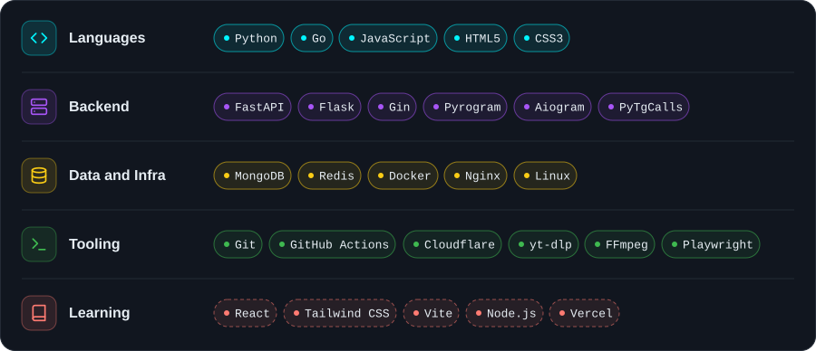

 

<table>
  <tr>
    <td><a href="https://github.com/ScyxD/AnonXMusic"></a></td>
    <td><a href="https://beta.vibebots.fun"></a></td>
  </tr>
  <tr>
    <td><a href="https://github.com/Vibe-Bots"></a></td>
    <td><a href="https://github.com/ScyxD"></a></td>
  </tr>
  <tr>
    <td><a href="https://github.com/ScyxD"></a></td>
    <td><a href="https://github.com/Vibe-Bots"></a></td>
  </tr>
</table>

 

  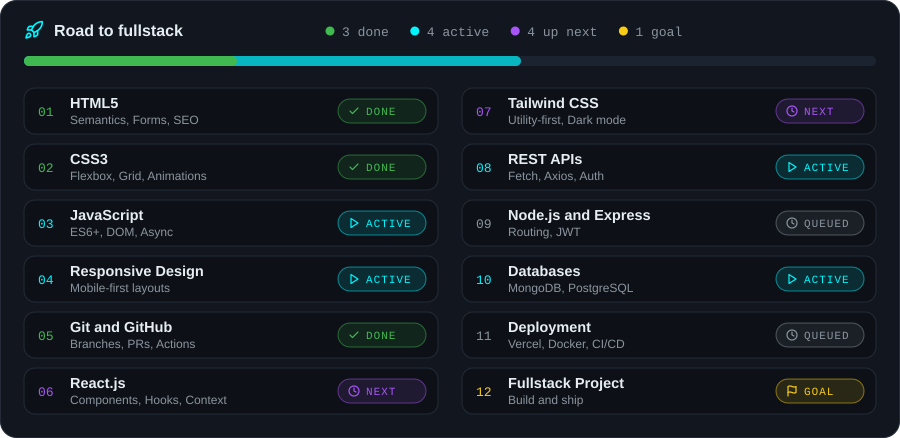

 

&nbsp;

  

 

  

 

<picture>
  <source media="(prefers-color-scheme: dark)" srcset="https://raw.githubusercontent.com/ScyxD/ScyxD/output/github-contribution-grid-snake-dark.svg"/>
  <source media="(prefers-color-scheme: light)" srcset="https://raw.githubusercontent.com/ScyxD/ScyxD/output/github-contribution-grid-snake.svg"/>
  
</picture>

 

  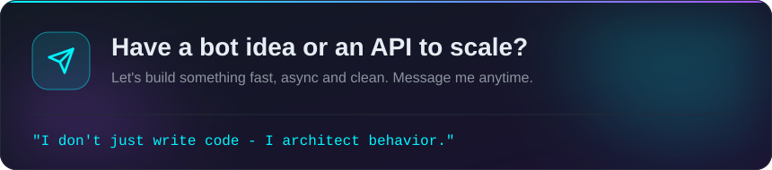
   
  
  
  
  

